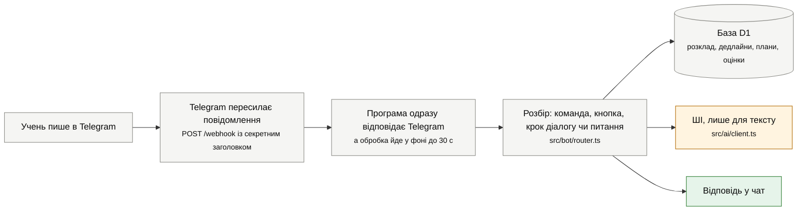
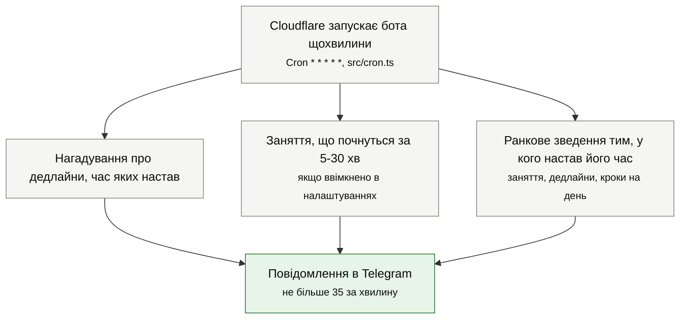
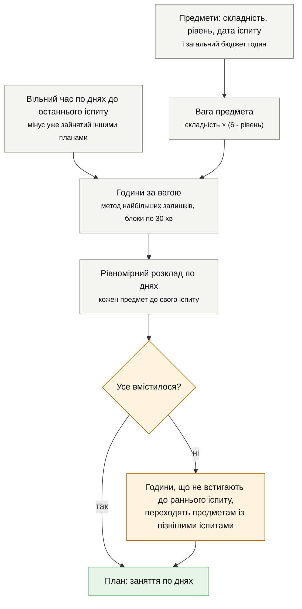
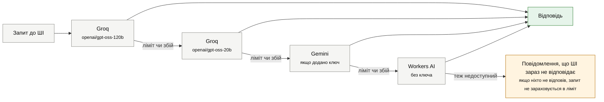

# Як бот влаштований

Бот складається з однієї програми на Cloudflare Workers і однієї бази D1. Telegram пересилає програмі кожне повідомлення, програма відповідає і щохвилини сама перевіряє, кому час нагадати. Усе, що можна порахувати формулою (дати, години, пріоритети, середній бал), рахується без ШІ, тому працює завжди. ШІ потрібен лише для тексту: конспектів, тестів, кроків завдання, порад і відповідей на питання.

## Що відбувається, коли учень пише боту

Чому відповідь іде "у фоні": Telegram чекає на підтвердження недовго й повторює запит, якщо не дочекався. Тому програма спершу каже Telegram "отримав", а потім спокійно звертається до бази й ШІ. На безкоштовному тарифі Cloudflare дає на це до 30 секунд, і всі спроби ШІ разом укладаються в 23 секунди.

Коли бот чекає від людини конкретної відповіді (наприклад, тексту дедлайну після кнопки "Додати"), він записує в базу "крок діалогу" (`users.state`). Кнопки головного меню і `/cancel` цей крок скидають.

## Що бот робить щохвилини

Обмеження в 35 повідомлень за хвилину взялося з безкоштовного тарифу: один запуск може зробити не більше 50 зовнішніх запитів. Що не вмістилося, піде наступної хвилини. Раз на добу той самий запуск прибирає старі записи.

**Коли нагадує про дедлайн** (`src/reminders.ts`):

- дедлайн із часом: за добу, за 2 години і в сам момент;
- дедлайн "до кінця дня": напередодні о 19:00 і того ж дня о 8:00;
- якщо до дедлайну 4 дні й більше, ще й за 3 дні о 19:00;
- нічних нагадувань немає: те, що випадає на 22:00-8:00, переноситься на 21:00 (крім нагадування в сам момент дедлайну).

Час завжди рахується в поясі користувача (за замовчуванням Київ), з урахуванням переходу на літній і зимовий час.

## Як рахуються години на предмети

Це серце розділу "🎯 План підготовки" (`src/planner.ts`). Людина вказує предмети, для кожного складність (1-5), свій рівень (1-5) і дату іспиту, а також скільки годин готова витратити. Вільний час на кожен день тижня береться з налаштувань.

1. **Вага.** Що складніший предмет і що слабша підготовка, то більше часу: вага = складність × (6 - рівень). Найлегший випадок дає 1, найважчий 25.
2. **Години.** Бюджет ділиться пропорційно вагам блоками по 30 хвилин. Залишкові блоки отримують предмети з найбільшою дробовою частиною (при рівності предмет із більшою вагою), тож сума завжди точно дорівнює бюджету.
3. **Розклад.** Години кожного предмета розтягуються рівномірно на дні до його іспиту. Щодня першим іде предмет, що найбільше відстав від свого темпу; якщо предметам із ранніми іспитами разом ледь вистачає часу, вони йдуть першими. Один предмет займає не більше 2 годин на день, якщо його є чим чергувати і він устигає до іспиту.
4. **Нестача часу.** Якщо до раннього іспиту години не вміщаються, решта переходить предметам із пізнішими датами, а бот попереджає. Якщо бюджет більший за весь вільний час, план будується на весь вільний час, і про це теж буде попередження.

**Приклад: 12 годин на три предмети.** Вільного часу 2 години щодня, план починається 2 листопада.

| Предмет | Складність | Рівень | Іспит | Вага | Годин |
|---|---|---|---|---|---|
| Математика | 5 | 2 | 12 листопада | 5 × 4 = 20 | 7,5 |
| Фізика | 3 | 3 | 16 листопада | 3 × 3 = 9 | 3 |
| Англійська | 2 | 4 | 22 листопада | 2 × 2 = 4 | 1,5 |

12 годин це 24 блоки по 30 хвилин. За вагами виходить 14,55, 6,55 і 2,91 блока. Цілі частини дають 14 + 6 + 2 = 22 блоки, два блоки, що лишилися, отримують англійська (залишок 0,91) і математика (залишок 0,55, як і у фізики, але вага більша). Разом 15, 6 і 3 блоки, тобто 7,5, 3 і 1,5 години.

Розклад, який будує бот:

| День | Заняття |
|---|---|
| пн 2.11 | Математика 1 год |
| вт 3.11 | Математика 30 хв, Фізика 30 хв |
| ср 4.11 | Математика 1 год |
| чт 5.11 | Математика 30 хв, Фізика 30 хв |
| пт 6.11 | Математика 30 хв, Англійська 30 хв |
| сб 7.11 | Математика 1 год |
| нд 8.11 | Математика 1 год, Фізика 30 хв |
| пн 9.11 | Математика 30 хв, Фізика 30 хв |
| вт 10.11 | Математика 1 год |
| ср 11.11 | Математика 30 хв, Англійська 30 хв |
| пт 13.11 | Фізика 30 хв |
| сб 14.11 | Фізика 30 хв |
| ср 18.11 | Англійська 30 хв |

Математика закінчується за день до свого іспиту, фізика і англійська теж встигають, а жоден день не забирає більше 1,5 години з двох вільних. Цей приклад перевіряє автоматичний тест у `test/unit/planner-grades.test.ts`.

Збережений план стає завданням із заняттями по днях. Заняття на сьогодні з'являються в ранковому зведенні, а позначене виконаним заняття записує свій час у статистику.

## Як визначається пріоритет дедлайну

Список дедлайнів упорядкований за числом

пріоритет = (2 × важливість + складність) × терміновість,

де важливість і складність від 1 до 3 (людина вибирає кнопками після створення дедлайну), а терміновість = 1 / (днів до дедлайну + 1), для простроченого 2. Від 3 і вище це 🔴 "зробити першим", від 1 до 3 🟡 "найближчим часом", нижче 🟢 "є запас часу". Наприклад, важливий (3) і складний (3) дедлайн через 2 дні має (6 + 3) × 1/3 = 3, тобто 🔴; звичайний (2 і 2) через тиждень має 6 × 1/8 = 0,75, тобто 🟢.

## Як розкладаються кроки великого завдання

ШІ ділить завдання на 3-10 кроків і оцінює тривалість кожного. Далі бот без ШІ ставить кроки по порядку на найближчі дні, де вистачає вільного часу (з урахуванням занять інших планів), і завершує за день до дедлайну. Якщо кроки не вміщаються, вони розподіляються рівномірно до дедлайну, а бот попереджає, скільки часу доведеться додати понад звичний вільний.

## Прогрес, оцінки і графіки

- **Прогрес** (`src/bot/features/progress.ts`): відсоток виконаних кроків і занять за 7 днів і за весь час, кількість дедлайнів, виконаних вчасно. Час навчання записується таймером, вручну ("45 хв фізика") або автоматично, коли людина позначає заняття плану виконаним.
- **Оцінки** (`src/grades.ts`): зважений середній по кожному предмету. Щоб отримати підсумкову N, середній має бути не меншим за N - 0,5 (округлення "половина вгору"). Бот рахує, який середній потрібен з наступних 1-5 оцінок і скільки максимальних оцінок поспіль вистачить.
- **Графіки**: текстові смуги прямо в чаті і сторінка з графіками (`src/web/charts.ts`), що відкривається кнопкою всередині Telegram. Посилання підписане секретом і діє добу, тож чужі дані за ним не побачити.

## ШІ із запасними варіантами

Порядок задає `AI_PROVIDERS` у `wrangler.jsonc`, провайдери без ключа пропускаються. За замовчуванням це `groq,gemini,custom,workers`, де `custom` означає будь-який інший OpenAI-сумісний сервіс, якщо задано його адресу й ключ (див. [recipes.md](recipes.md)); на схемі його не показано. Коли від ШІ потрібні дані (тест, кроки, розклад), бот просить JSON і перевіряє його: неправильну відповідь відкидає й питає наступного. Кожен користувач має денний ліміт запитів (`AI_DAILY_LIMIT`, 40), щоб один активний учень не вичерпав безкоштовний ліміт для всіх.

Факти про НМТ, які ШІ отримує для порад, лежать у константі `NMT_FACTS` у `src/ai/prompts.ts` (джерела на testportal.gov.ua вказано в коментарі над нею). Коли оголосять формат і календар НМТ-2027, оновити доведеться ще кілька місць: їх перелічено в [recipes.md](recipes.md), розділ "Оновити факти про НМТ".

## Безпека і приватність

- Запити на `/webhook` без правильного секретного заголовка відхиляються, тож підробити повідомлення від Telegram не вийде.
- Сторінка `/setup` працює лише з секретом у посиланні.
- Кожен запит до бази фільтрує дані за id користувача: навіть підробивши кнопку, чужий запис змінити не можна.
- Кнопка "🗑 Видалити мої дані" в налаштуваннях стирає розклад, дедлайни, плани, оцінки й історію навчання.
- Текст запитів до ШІ йде до обраного провайдера (Groq, Gemini чи Cloudflare). Не варто надсилати боту особисті дані.
