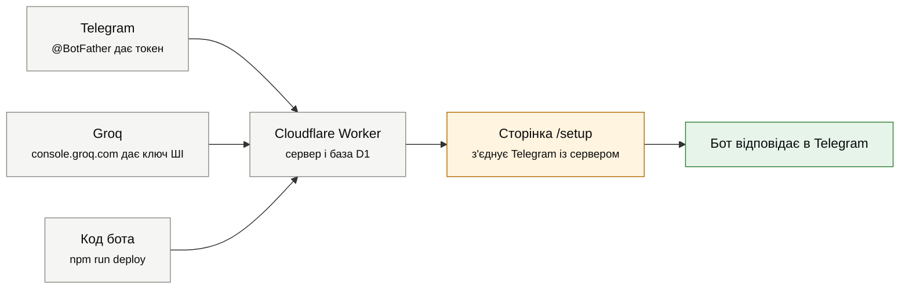

# Як запустити бота з нуля

Після цих кроків бот працюватиме цілодобово в інтернеті, навіть коли ваш комп'ютер вимкнений, і нічого не коштуватиме. Займе це близько 30-40 хвилин, більшість часу йде на реєстрацію акаунтів.

Що відбувається загалом: ви берете в Telegram "паспорт" бота (токен), у Groq ключ до штучного інтелекту, публікуєте код на безкоштовному сервері Cloudflare і віддаєте йому токен і ключ. Потім одна службова сторінка з'єднує Telegram із сервером.



## Що знадобиться

- Комп'ютер з Windows, macOS або Linux. На Windows зручно працювати у WSL, але підійде й звичайний термінал PowerShell.
- **Node.js 22.12 або новіший.** Перевірити: `node -v`. Якщо версія старіша або Node немає, встановіть LTS-версію з [nodejs.org](https://nodejs.org).
- **Git.** Перевірити: `git --version`.
- Телефон чи комп'ютер з Telegram.
- Пошта для реєстрації в Cloudflare і Groq.

## Крок 1. Створіть бота в Telegram

1. Відкрийте в Telegram [@BotFather](https://t.me/BotFather) і надішліть `/newbot`.
2. Введіть назву, яку бачитимуть люди, наприклад `StudyBot Олі`.
3. Введіть ім'я користувача латиницею, що закінчується на `bot`, наприклад `olya_study_helper_bot`. Якщо зайняте, BotFather попросить інше.
4. BotFather надішле **токен** вигляду `123456789:AAH...`. Збережіть його: це пароль від бота, нікому його не показуйте.

Опис бота й меню команд налаштовувати не треба: це зробить сторінка `/setup` на кроці 9. Аватарку за бажанням поставте в @BotFather командою `/setuserpic`.

## Крок 2. Отримайте безкоштовний ключ ШІ

Без ключа Groq бот теж працює: конспекти, тести, розбивку завдань і поради тоді робить запасний ШІ від Cloudflare (Workers AI). Його безкоштовного ліміту вистачає приблизно на 200-250 коротких відповідей на добу на всіх користувачів разом, тож ключ Groq краще додати.

1. Зайдіть на [console.groq.com](https://console.groq.com) і зареєструйтеся (через Google, GitHub чи пошту).
2. Відкрийте розділ **API Keys** і натисніть **Create API Key**.
3. Скопіюйте ключ вигляду `gsk_...`. Groq показує його лише один раз.

Безкоштовний план Groq дає кожній моделі близько 1000 запитів на добу, а бот використовує дві моделі по черзі. Точні ліміти вашого акаунта видно в розділі **Limits** на сайті Groq.

## Крок 3. Завантажте код і встановіть залежності

```bash
git clone https://github.com/AndryWJ/studybot.git
cd studybot
npm install
```

Якщо код лежить у вас просто в папці (ще не на GitHub), пропустіть `git clone` і перейдіть у цю папку командою `cd`.

`npm install` завантажить інструменти розробки в папку `node_modules/` (близько 300 МБ). Повідомлення `npm audit` про вразливості стосуються лише цих локальних інструментів, на сервер вони не потрапляють.

## Крок 4. Увійдіть у Cloudflare

1. Зареєструйтеся на [dash.cloudflare.com/sign-up](https://dash.cloudflare.com/sign-up) і підтвердьте пошту.
2. У терміналі виконайте:

```bash
npx wrangler login
```

Відкриється браузер, натисніть **Allow**. Якщо браузер не відкрився або сторінка після дозволу каже "This site can't be reached" (буває у WSL і на віддалених серверах), виконайте замість цього:

```bash
npx wrangler login --device
```

Команда покаже адресу й код: відкрийте адресу в будь-якому браузері й введіть код.

Перевірити, що вхід вдався: `npx wrangler whoami`.

## Крок 5. Створіть базу даних

```bash
npx wrangler d1 create studybot --location eeur --binding DB
```

`--location eeur` розміщує базу в Східній Європі, ближче до України. `--binding DB` каже wrangler одразу вписати id нової бази у файл `wrangler.jsonc`, у блок, де код бота шукає базу під ім'ям `DB`. Після команди відкрийте `wrangler.jsonc` і перевірте, що в рядку `"database_id"` стоїть саме той id, який wrangler щойно показав (вигляду `3f2a...-...`): він заміняє id, що був у файлі. Wrangler може переформатувати файл відступами, це нормально.

Якщо запустити команду без `--binding DB`, wrangler поставить три питання. Відповідайте так:

| Питання | Відповідь |
|---|---|
| Would you like Wrangler to add it on your behalf? | `y` |
| What binding name would you like to use? | `DB`, саме великими літерами |
| For local dev, do you want to connect to the remote resource instead of a local resource? | `N` (просто Enter) |

Якщо на друге питання ви вже ввели інше ім'я, у `wrangler.jsonc` з'явиться другий блок бази: як це виправити, описано в розділі "Якщо щось пішло не так".

## Крок 6. Створіть таблиці

```bash
npm run db:migrate
```

Wrangler спитає підтвердження, натисніть `y`. Команда створить у базі таблиці з файлу `migrations/0001_init.sql`.

## Крок 7. Опублікуйте бота

```bash
npm run deploy
```

Під час першої публікації Cloudflare попросить вибрати піддомен `workers.dev`, наприклад `olya`. Наприкінці з'явиться адреса бота: `https://studybot.olya.workers.dev`. Запишіть її.

У виводі також буде рядок про розклад `* * * * *`: це щохвилинний запуск, який надсилає нагадування.

## Крок 8. Додайте секрети

Секрети зберігаються в Cloudflare зашифрованими й не потрапляють у код. Кожна команда попросить вставити значення.

Спершу придумайте **WEBHOOK_SECRET**: довгий випадковий рядок, яким Telegram підписуватиме свої запити. Найпростіше згенерувати його так:

```bash
node -e "console.log(require('crypto').randomBytes(24).toString('hex'))"
```

Збережіть цей рядок у нотатках: Cloudflare не покаже його вдруге, а на кроці 9 він знадобиться в посиланні.

Тепер додайте три секрети:

```bash
npx wrangler secret put TELEGRAM_BOT_TOKEN   # токен з кроку 1
npx wrangler secret put WEBHOOK_SECRET       # рядок, який ви щойно згенерували
npx wrangler secret put GROQ_API_KEY         # ключ з кроку 2
```

## Крок 9. Підключіть бота до Telegram

Відкрийте в браузері адресу з кроку 7, додавши в кінці `/setup?secret=` і ваш WEBHOOK_SECRET:

```
https://studybot.olya.workers.dev/setup?secret=ваш_WEBHOOK_SECRET
```

Сторінка сама зареєструє бота в Telegram, налаштує меню команд і опис та перевірить базу й ШІ. Якщо все гаразд, вгорі буде **"StudyBot готовий 🎉"**, а нижче зелені позначки. Попередження про фото нормальне: розпізнавання фото вмикається окремо (див. нижче).

Сторінку можна відкривати повторно скільки завгодно, наприклад після зміни токена.

## Крок 10. Перевірте в Telegram

Знайдіть бота за іменем з кроку 1, натисніть **Почати** (в англійському Telegram **Start**) або надішліть `/start`. Спробуйте:

- `нагадай здати реферат завтра о 18` (дедлайн з нагадуваннями);
- кнопку **🎯 План підготовки** (розрахунок годин на предмети);
- просто питання, наприклад `поясни, що таке похідна` (відповідь ШІ).

Усі розділи бота з прикладами фраз описано в [usage.md](usage.md). Цю інструкцію можна переслати учням, які користуватимуться ботом.

## Необов'язкові налаштування

Ці налаштування не секретні: їх змінюють прямо в розділі `vars` файлу `wrangler.jsonc`, а потім виконують `npm run deploy`.

| Що | Як |
|---|---|
| Команда `/stats` для вас | Дізнайтеся свій Telegram id (наприклад, у [@userinfobot](https://t.me/userinfobot)) і впишіть у `"ADMIN_ID"` |
| Бот лише для своїх | Впишіть id друзів через кому в `"ALLOWED_USERS"`; решта отримає відповідь, що бот приватний |
| Ліміт запитів до ШІ на людину | `"AI_DAILY_LIMIT"`, за замовчуванням 40 на добу |
| Розпізнавання фото сторінок | Додайте ключ Gemini: `npx wrangler secret put GEMINI_API_KEY` (ключ на [aistudio.google.com](https://aistudio.google.com/api-keys)). Зважте застереження нижче |

**Про Gemini.** Безкоштовний тариф Google дозволяє використовувати надіслані тексти для покращення своїх продуктів, а умови Gemini API забороняють сервіси, якими ймовірно користуються люди молодші за 18 років. Для бота школярів безпечніше лишити основним Groq.

**Workers AI** уже підключено (`"ai"` у `wrangler.jsonc`): це запасний ШІ від Cloudflare без окремого ключа. Він вмикається, коли Groq недоступний.

## Що безкоштовно і де межі

| Сервіс | Безкоштовно | Що буде, якщо перевищити |
|---|---|---|
| Cloudflare Workers | 100 000 запитів на добу, до 10 мс роботи процесора на один запит | Бот не відповідатиме до 00:00 UTC (02:00 взимку і 03:00 влітку за Києвом) |
| Щохвилинний запуск (Cron) | До 5 розкладів на акаунт, бот використовує один | Не перевищується |
| База D1 | 500 МБ на одну базу (5 ГБ на весь акаунт), 5 млн прочитаних і 100 тис. записаних рядків на добу | Запити до бази повертатимуть помилку до 00:00 UTC |
| Groq | Кожна з двох моделей: 30 запитів і 8 тис. токенів на хвилину, 1000 запитів і 200 тис. токенів на добу. Раніше закінчуються токени: орієнтовно це 100-200 відповідей на добу на модель | Бот перемкнеться на наступну модель, потім на Workers AI |
| Workers AI | 10 000 "нейронів" на добу, це приблизно 200-250 коротких відповідей | Бот напише, що ШІ зараз не відповідає |

Розклад, дедлайни, нагадування, план підготовки, прогрес і оцінки працюють без ШІ взагалі, тож навіть коли ліміти ШІ вичерпано, основне не ламається. Для кількох десятків активних учнів безкоштовних лімітів достатньо.

## Якщо щось пішло не так

| Що бачите | Чому | Що зробити |
|---|---|---|
| Бот мовчить на `/start` | Не відкрито сторінку `/setup` або змінився токен | Відкрийте `/setup?secret=...` ще раз і подивіться, що там червоне |
| `/setup` пише "forbidden" | У посиланні не той секрет | Скопіюйте WEBHOOK_SECRET точно; якщо забули, задайте новий (крок 8) і відкрийте `/setup` з ним |
| `/setup` пише "WEBHOOK_SECRET не задано або він закороткий" | Секрет не додано або в ньому менше 16 символів чи недозволені символи | Згенеруйте рядок командою з кроку 8 |
| На `/setup` червоне "База D1" | Таблиць немає або в `wrangler.jsonc` не той `database_id` | Перевірте `database_id`, виконайте `npm run db:migrate`, потім `npm run deploy` |
| На `/setup` червоне "Токен бота" | Токен вставлено з помилкою | `npx wrangler secret put TELEGRAM_BOT_TOKEN` ще раз |
| Бот пише "ШІ ще не підключено" | Не лишилося жодного ШІ: з `AI_PROVIDERS` у `wrangler.jsonc` прибрано `workers` (або сам рядок `"ai"`), а ключів немає | Додайте ключ: `npx wrangler secret put GROQ_API_KEY`. Або поверніть `workers` і `"ai"` та виконайте `npm run deploy` |
| Бот пише "ШІ зараз не відповідає" | Вичерпано ліміти Groq і Workers AI або в сервісах збій | Зачекайте кілька хвилин; причину покаже `npm run logs` |
| Не приходять нагадування | Щохвилинний запуск вмикається протягом кількох хвилин після першої публікації, бота заблоковано в Telegram, або всі часи нагадувань цього дедлайну вже минули | Зачекайте до 15 хвилин після першого `deploy`; розблокуйте бота й надішліть `/start`. Коли нагадає, бот пише одразу після збереження дедлайну |
| `npm run deploy` пише про `database_id` | У `wrangler.jsonc` не id вашої бази: нулі або id з репозиторію, звідки взято код | Впишіть id з відповіді `npx wrangler d1 create` (крок 5). Забули id: `npx wrangler d1 list` |
| У `wrangler.jsonc` у `d1_databases` два блоки | На питання wrangler "What binding name" введено не `DB` | Скопіюйте `database_id` з нового блоку в блок з `"binding": "DB"`, а новий блок видаліть разом із комою перед ним |
| `wrangler` пише про версію Node.js | Node.js старіший за 22.12 | Встановіть LTS-версію з [nodejs.org](https://nodejs.org) і перевірте `node -v` |

## Як оновити бота після змін у коді

```bash
npm test          # переконатися, що нічого не зламано
npm run deploy    # опублікувати нову версію
```

Якщо в папці `migrations/` з'явився новий файл, перед `deploy` виконайте `npm run db:migrate`.
