# Як користуватися ботом

Ця інструкція для учня, який відкриває StudyBot уперше. Бот живе в Telegram, тож нічого встановлювати не треба: пишеш йому в чат, як другові, або натискаєш кнопки меню внизу екрана.

Більшість речей бот робить сам, без штучного інтелекту, тому вони працюють завжди: розклад, дедлайни й нагадування, план підготовки, таймер, прогрес і оцінки. Конспекти, тести, розбивка завдань на кроки й відповіді на питання потребують ШІ. У цій інструкції вони позначені 🤖. На такі запити є денний ліміт (за замовчуванням 40 на людину), а коли він закінчиться, бот скаже, о котрій ліміт оновиться.

## Перші кроки

1. Знайди бота в Telegram за іменем (його скаже той, хто запустив бота) і натисни **Почати** (у Telegram англійською ця кнопка зветься **Start**) або надішли `/start`.
2. Бот привітається й запропонує почати з однієї з трьох кнопок: **➕ Додати дедлайн**, **📅 Заповнити розклад** або **🎯 План до НМТ чи іспитів**.
3. Внизу екрана з'явиться меню з десяти кнопок. Якщо воно зникло, надішли `/start` чи `/help`, і меню повернеться.
4. Зазирни в **⚙️ Налаштування** і вкажи, скільки часу на день можеш вчитися поза уроками. Від цього залежить, як бот розкладає заняття й кроки завдань. Поки не зміниш, бот вважає, що це пн-пт по 2 години, сб 3 години і нд 1 година.

## Що можна просто написати

Ці фрази працюють будь-коли, без натискання кнопок:

| Що написати | Що зробить бот |
|---|---|
| `нагадай здати реферат завтра о 18` | Запише дедлайн і нагадає про нього |
| `дедлайн контрольна з фізики в четвер о 10` | Те саме: повідомлення, що починається зі слів "нагадай" чи "дедлайн", стає дедлайном |
| `/add есе 12.11 23:00` | Те саме командою |
| `поясни, що таке похідна` 🤖 | Відповість на питання з будь-якого предмета |
| `/summary Причини Першої світової війни` 🤖 | Зробить короткий конспект теми |
| `/quiz 7 питань з теми Київська Русь` 🤖 | Складе тест із 7 питань |
| `/split написати курсову з історії до 15 грудня` 🤖 | Розіб'є завдання на кроки по днях і запише дедлайн |
| `/timer хімія` | Запустить таймер навчання; поки він іде, будь-яке `/timer` його зупинить і запише час |
| `/today` | Покаже, що на сьогодні: уроки, найближчі дедлайни й кроки завдань |

## Розклад уроків і занять

Кнопка **📅 Розклад** показує тиждень по днях. Під ним кнопки **➕ Додати заняття**, **🤖 Скласти з ШІ**, а коли розклад уже є, ще **📆 Сьогодні** і **🗑 Видалити**.

**Додати заняття.** Натисни **➕ Додати заняття** і напиши заняття по одному на рядок у форматі "день час назва":

```
пн 08:30-09:15 Математика
вт, чт 15:00 Англійська
пн-пт 19:00-20:00 Підготовка до НМТ
щодня 21:00 Читання
```

Бот покаже, що додав, і окремо рядки, яких не зрозумів. Якщо в повідомленні жодного рядка в такому форматі немає (наприклад, `у середу з 16 до 17 гурток з робототехніки`), бот попросить ШІ 🤖 перетворити текст на заняття. Однакові заняття двічі не додаються, а всього їх може бути до 100.

**Скласти з ШІ** 🤖. Опиши свій тиждень: коли уроки, гуртки, коли є вільний час і що хочеш встигати. Бот покаже чернетку розкладу. Якщо щось не подобається, просто напиши побажання (`у суботу менше занять`), і чернетка зміниться. Кнопка **✅ Додати в розклад** записує чернетку, **♻️ Замінити мій розклад** записує її замість наявного, **🔁 Інший варіант** просить новий.

**Видалити.** **🗑 Видалити**, потім день і заняття, яке треба прибрати. Там само є **🧹 Очистити весь розклад**, бот перепитає перед очищенням.

Нагадування за кілька хвилин до уроку за замовчуванням вимкнені. Увімкнути: **⚙️ Налаштування**, далі **🔔 Про заняття**, вибери за 5, 10, 15 чи 30 хвилин.

## Дедлайни і нагадування

Додати дедлайн можна трьома способами: кнопкою **⏰ Дедлайни**, далі **➕ Додати дедлайн**; командою `/add`; або повідомленням, що починається зі слів "нагадай" чи "дедлайн". Дату й час бот розуміє зі звичайних фраз:

```
Реферат з біології 15.11 18:00
Курсова з історії до 20 грудня
Контрольна з фізики в четвер о 10
Взяти форму на фізру завтра
через 2 години подзвонити
```

Якщо час не вказано, дедлайн вважається "до кінця дня". Незвичну фразу, яку бот не розібрав сам, він спробує зрозуміти через ШІ 🤖.

Після збереження бот одразу пише, коли саме нагадає, і показує два ряди кнопок: **❗ важливість** (низька, середня, висока) і **💪 складність** (легко, середньо, важко). Спочатку стоять середні значення, їх можна не чіпати.

Коли бот нагадує:
- дедлайн із часом: за добу, за 2 години і в сам момент;
- дедлайн "до кінця дня": напередодні о 19:00 і того ж дня о 8:00;
- якщо до дедлайну 4 дні й більше, ще й за 3 дні о 19:00;
- уночі (з 22:00 до 8:00) не будить: такі нагадування приходять о 21:00, крім нагадування в сам момент дедлайну;
- нагадування, час якого вже минув, не надсилається, тож для дедлайну "через 2 години" буде лише одне.

Кнопка **⏰ Дедлайни** показує до 10 відкритих дедлайнів, від найвищого пріоритету:
- 🔴 зробити першим;
- 🟡 найближчим часом;
- 🟢 є запас часу.

Дедлайн стоїть у списку вище, коли термін ближчий, а важливість і складність більші. Біля кожного номера є кнопки **✅** (виконано), **🧩** (розбити на кроки) і **🗑** (видалити, бот перепитає).

## План підготовки до НМТ чи іспитів

Кнопка **🎯 План підготовки** рахує, скільки годин дати кожному предмету, і розкладає заняття по твоїх вільних днях так, щоб кожен предмет устиг до свого іспиту. Усе рахується без ШІ.

```mermaid
flowchart LR
  A["До чого готуємося<br/><small>НМТ, іспити чи свої предмети</small>"]:::neutral --> B["Предмети й дати<br/><small>кнопками або списком</small>"]:::neutral
  B --> C["Складність і рівень<br/><small>кнопки 💪 і 📚</small>"]:::neutral
  C --> D["Скільки годин<br/><small>число або весь вільний час</small>"]:::neutral
  D --> E["Розрахунок<br/><small>можна змінити складність, рівень чи години</small>"]:::attention
  E --> F["План збережено<br/><small>заняття приходять щоранку</small>"]:::result
  classDef result fill:#e6f4ea,stroke:#2e7d32,stroke-width:1px,color:#0b0b0b
  classDef attention fill:#fff4e0,stroke:#b26a00,stroke-width:1px,color:#0b0b0b
  classDef neutral fill:#f5f5f3,stroke:#8a8a85,stroke-width:1px,color:#0b0b0b
```



1. **До чого готуємося.** **🎓 НМТ**, **📚 Іспити / сесія** або **📝 Свої предмети**.
2. **Предмети.**
   - Для НМТ українська мова, математика й історія України вже відмічені. Відміть ще предмет, який складатимеш на вибір (кожне натискання ставить або знімає позначку), і натисни **Далі ▶️**. Потім напиши дату (наприклад, `20.05.2027`) або натисни кнопку з орієнтовною датою: офіційний календар НМТ-2027 ще не оголошено.
   - Для іспитів і своїх предметів напиши їх по одному на рядок, з датою іспиту, якщо вона є. Предметів може бути до 8. Предмет без дати бот планує на 4 тижні вперед, а якщо найпізніший іспит зі списку ще далі, то до дати цього іспиту.

     ```
     Вища математика 20.01
     Фізика 25.01
     Англійська
     ```
3. **Складність і рівень.** Біля кожного предмета дві кнопки: **💪** складність для тебе (1 легко, 5 дуже важко) і **📚** твій рівень зараз (1 слабкий, 5 сильний). Кожне натискання додає 1, після 5 знову 1. Потім **Далі ▶️**.
4. **Скільки годин.**
   - Напиши, скільки годин усього можеш витратити (наприклад, `12`), або натисни **Весь вільний час ▶️**.
   - Бот підкаже, скільки вільного часу в тебе до іспитів.
   - Кнопки **Будні 1 год, вихідні 2** і подібні змінюють твій вільний час у налаштуваннях, тож він діятиме і для інших планів та завдань. Бот перерахує години до іспитів, а далі все одно напиши число або натисни **Весь вільний час ▶️**.
5. **Розрахунок.**
   - Бот покаже години на кожен предмет, перші дні плану й попередження, якщо часу замало.
   - Складніший предмет і слабший рівень отримують більше годин.
   - Якщо години предмета не вміщаються до його іспиту, бот віддає зайві предметам з пізнішими іспитами і попереджає про це. Якщо віддати нікому, бот скаже, скільки годин не вмістилося.
   - **⚖️ Змінити оцінки** повертає до кроку 3 (тут "оцінки" означають складність і рівень предметів, а не шкільні оцінки), **⏱ Змінити години** повертає до кроку 4. **🤖 Що вчити: поради ШІ** підкаже, на які теми звернути увагу.
6. **✅ Зберегти план.**
   - Бот покаже картку плану з заняттями на найближчі 7 днів.
   - Коли заняття пройдено, натисни його номер: час запишеться в прогрес.
   - Дати іспитів потраплять у дедлайни з нагадуваннями, а заняття на день щоранку приходитимуть у ранковому зведенні: це коротке повідомлення від бота з уроками, дедлайнами й кроками на день.
   - Новий план НМТ замінює попередній план НМТ. План іспитів чи своїх предметів замінює старий, лише якщо предмети записано так само і в тому самому порядку. Відмітки про пройдені заняття в заміненому плані зникають.

Якщо цікаво, як саме бот ділить години, приклад на 12 годин і три предмети є в [how-it-works.md](how-it-works.md), розділ "Як рахуються години на предмети". Для користування ботом читати його не обов'язково.

## Велике завдання по кроках 🤖

Кнопка **🧩 Розбити завдання**: опиши завдання й допиши дедлайн, якщо він є, наприклад `написати курсову з історії на 25 сторінок до 15 грудня`.

ШІ ділить завдання на кроки (зазвичай від 3 до 10) і оцінює, скільки часу займе кожен. Далі бот сам ставить кроки по порядку на твої вільні дні до дедлайну, з урахуванням занять плану підготовки. Якщо в тексті був дедлайн, бот запише і його, з нагадуваннями. Якщо до дедлайну не вистачає вільного часу, бот попередить, скільки доведеться додати понад звичний.

Коли крок виконано, натисни його номер під карткою: час кроку запишеться в прогрес. Коли всі кроки готові, бот запропонує закрити й дедлайн. Розбити можна і вже записаний дедлайн: кнопка **🧩** біля нього в списку дедлайнів. Усі завдання й плани відкриває команда `/tasks`.

## Конспект і тест 🤖

**📝 Конспект.** Надішли тему (`Причини Першої світової війни`), текст або текстовий файл .txt, і бот зробить короткий конспект. Фото сторінки бот розуміє лише тоді, коли власник бота підключив ШІ, що розпізнає зображення; інакше бот так і скаже. З тексту бот бере перші 8000 символів. Під конспектом є кнопка **❓ Тест за конспектом**: вона складе тест із 5 питань за цим конспектом. Кнопка працює, поки бот пам'ятає конспект (близько двох годин і кілька наступних питань); під старим конспектом бот просто спитає, про що тест.

**❓ Тест.** Напиши тему чи встав текст. Кількість питань можна вказати від 3 до 10 (`7 питань з теми Київська Русь`), без цього їх буде 5. Питання приходять вікторинами Telegram по одному: вибираєш відповідь, і бот надсилає наступне. Наприкінці бот покаже бал і запропонує **🔁 Ще тест на цю тему** чи **📝 Конспект теми**.

Якщо надіслати боту фото чи текстовий файл без команди, він сам спитає, що з ним зробити: конспект чи тест. Якщо ж бот у цей момент чекає відповіді на інше питання, він попросить спершу закінчити ту дію або натиснути `/cancel`.

## Питання з будь-якого предмета 🤖

Просто напиши питання, наприклад `поясни, що таке похідна` або `як розв'язати x² - 5x + 6 = 0`. Протягом двох годин бот пам'ятає кілька останніх реплік, тож можна уточнити: `а можна простіший приклад?`.

Якщо питання починається зі слова "нагадай", але дати в ньому немає (`нагадай, що таке інтеграл`), бот теж сприйме його як питання, а не як дедлайн.

## Скільки ти вчишся: таймер і прогрес

**Таймер.** **📊 Прогрес**, далі **⏱ Почати заняття**: вибери предмет із недавніх або напиши назву. Коли закінчиш, натисни **⏹ Стоп**. Те саме командою: `/timer хімія` запускає таймер, а `/timer` зупиняє. Поки таймер іде, будь-яке `/timer` зупиняє його, навіть із назвою предмета: щоб перейти на інший предмет, зупини поточний і запусти новий. Час округлюється до хвилини, тож зовсім коротке заняття (до пів хвилини) бот не записує, а понад 4 години записує лише 4 години.

**Записати час вручну.** **➕ Записати час**, далі `45 хв математика`, `1.5 год фізика` або `1:20 англійська`. Виконані кроки завдань і заняття плану підготовки записують свій час самі.

**📊 Прогрес** показує:
- скільки часу пішло на навчання сьогодні й за 7 днів, і порівняння з попередніми 7 днями;
- скільки кроків і занять плану виконано за тиждень і загалом;
- скільки дедлайнів закрито вчасно;
- графіки часу по днях і по предметах прямо в повідомленні.

Кнопка **📈 Детальні графіки** відкриває сторінку з графіками всередині Telegram. Посилання діє добу, потім просто відкрий **📊 Прогрес** ще раз.

## Оцінки і скільки треба для бажаної

**🎓 Оцінки**, далі **➕ Додати оцінки**, і напиши по предмету на рядок:

```
Математика 10 11 9
Фізика 8, 7x2
Англійська 12
```

`7x2` означає оцінку 7 з вагою 2, наприклад за контрольну, що рахується двічі. Бот покаже середній бал з кожного предмета, загальний середній і найслабший предмет.

**🎯 Скільки треба?** Вибери предмет і оцінку, яку хочеш мати в підсумку. Бот скаже, яким має бути середній бал (для 10 це від 9,5), і порахує, який середній потрібен з наступних оцінок, якщо їх буде від 1 до 5. Окремо він підкаже найшвидший шлях, наприклад "3 оцінки по 12". Якщо бажана оцінка вже виходить, бот скаже, нижче якої оцінки краще не опускатися, а якщо вона недосяжна, так і скаже. Бот вважає підсумкову оцінку округленим середнім, а вчитель може враховувати й інше.

**🗑 Видалити останню** прибирає одну оцінку, додану останньою (бот скаже, яку саме). Якщо помилка в оцінці, введеній раніше, швидше натиснути **🧹 Очистити** (бот перепитає) і ввести все заново. Шкала за замовчуванням 12-бальна, 5- і 100-бальну можна вибрати в налаштуваннях.

## Налаштування

| Кнопка | Що змінює |
|---|---|
| 🌍 Пояс | Часовий пояс для нагадувань і зведення. За замовчуванням Київ; є кнопки для кількох поясів і поле для свого, наприклад `Europe/Vienna` |
| 🌅 Зведення | О котрій приходить ранкове зведення з уроками, дедлайнами й кроками на день (за замовчуванням 07:30). Можна написати свій час (`06:45`) або вимкнути. Якщо на день нічого не заплановано, зведення не приходить |
| 🔔 Про заняття | Нагадування за 5, 10, 15 чи 30 хвилин до уроку з розкладу, за замовчуванням вимкнено |
| 🕒 Вільний час | Скільки часу на день ти вчишся поза уроками: готові варіанти або по днях, наприклад `пн-пт 2, сб 4, нд 0` чи `будні 1.5 год, вихідні 3` |
| 🎓 Шкала оцінок | 12-, 5- чи 100-бальна. Якщо оцінки вже записані, перехід на іншу шкалу їх видалить, бот перепитає |
| 🗑 Видалити мої дані | Стирає розклад, дедлайни, завдання, плани, оцінки й історію навчання, а налаштування повертає до початкових. Ранкове зведення після цього вимкнене: щоб воно знову приходило, вибери час у **🌅 Зведення**. Скасувати видалення не можна |

## Усі команди

Команди є в меню команд Telegram біля поля вводу, а можна написати їх і вручну.

| Команда | Що робить |
|---|---|
| `/start` | Привітання і меню |
| `/today` | План на сьогодні |
| `/schedule` | Розклад на тиждень |
| `/deadlines` | Дедлайни за пріоритетом |
| `/add` | Додати дедлайн; можна одразу з текстом: `/add реферат 15.11 18:00` |
| `/tasks` | Завдання, розбиті на кроки, і плани підготовки |
| `/split` | Розбити завдання на кроки 🤖 |
| `/plan` | План підготовки до НМТ чи іспитів |
| `/progress` | Прогрес, час навчання і графіки |
| `/timer` | Запустити таймер, можна з предметом: `/timer хімія`. Якщо таймер уже йде, зупиняє його |
| `/grades` | Оцінки і середній бал |
| `/summary` | Конспект 🤖 |
| `/quiz` | Тест 🤖 |
| `/settings` | Налаштування |
| `/help` | Коротка довідка в самому боті |
| `/cancel` | Скасувати поточну дію |

## Якщо бот відповідає не так, як чекаєш

| Що бачиш | Що це означає і що робити |
|---|---|
| Бот сприймає твій текст як відповідь на своє питання | Бот чекає від тебе відповіді на своє питання, наприклад після **➕ Додати заняття**. Щоб вийти, натисни **❌ Скасувати**, будь-яку кнопку меню або `/cancel` |
| "На сьогодні ліміт запитів до ШІ вичерпано" | Денний ліміт запитів до ШІ закінчився. Бот пише, о котрій він оновиться; розклад, дедлайни, план і оцінки працюють і без ШІ |
| "ШІ зараз не відповідає" | Безкоштовні сервіси ШІ перевантажені. Спробуй за кілька хвилин |
| "Цей крок уже неактуальний" | Кнопка була під старим повідомленням. Почни дію заново, наприклад `/plan` |
| "Фото поки не розпізнаю" | До бота не підключено ШІ, що розпізнає зображення. Надішли текст |
| "Не знайшов дату чи час" | Допиши дату цифрами чи словами, наприклад `Есе з літератури 12.11 23:00` |
| "Це приватний бот" | Власник відкрив бота лише для своїх. Перешли йому свій Telegram id з цього повідомлення |
| Бот не відповідає в групі | Бот працює лише в особистому чаті |
